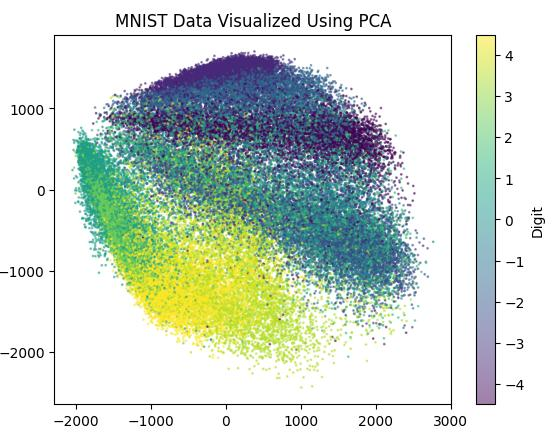

# Fashion MNIST dataset with PCA

In this project I have applied PCA(Principal Component Anylasis) in [Fashion MNIST dataset](https://www.kaggle.com/datasets/zalando-research/fashionmnist) in Kaggle. This markdown is just the overview of the project I have given more detail about PCA in my [notes](https://github.com/gitbhusalhubpramish/ml-notes/tree/main/0.009%20PCA). 

This image is just the final visulization of the PCA model. [Click here](fashion-mnist-pca-ilthlyynnldmohejzdxk58.streamlit.app) to see live preview.

## Small intro to PCA

Sooo..., PCA is a unsupervised meachine learning algorithm which helps us to reduce diamentions of our data. It finds the corelation or covariance of data then makes a vector which transfer the data where it include the info of most of the feature. There are $n$ number of Principal component in a PCA where $n$ is the number of feature but we can visulize the data or get  around 80% of the data after applying this.

## Feature

This project was made by me to understand PCA from scratch so it's main feature is it has PCA applied from scratch but also:

- PCA from scratch
- Numpy for maths and matrix calculation
- Data visulization
- Reduces or transforms 785 feature so we can visulize it from **2 features**.

## Tech-Stack

This project mostly(almost all) uses python liberies or technology related to math and datascience. I've used:

- Numpy for calculation
- matplotlib for datavisulization
- streamlit for hosting and building app
- Pandas for csv and data manipulation

## How it works

The flow looks like this:

- **Fetch data:** Here it fetches the data from kaggle dataset.
- **Mean Centring:** This is pre-processing stuff you do before finding principal components. It makes the mean of the data to 0. I don't have standerization :P.
- **Calculate Covariance:** This finds/calculate the covariance matrix; matrix of how each feature is related to each other.
- **Calculate eigenvalues and eginvector:** This is used to calculate principle component(it is kind of principal component) eignvector is considered as principal component when it is sorted in decending order with it's corresponding eigenvalues.
- **Visulize:** Here we visulize the data by transforming the data by multipling it with principal component with higest variance(eigenvalues) then plot in a graph.

## What I learnt

I made this project to learn PCA of cource I have learnt this but I have learnt these stuff too:

- PCA.
- Streamlit.
- numpy and matrix multipcation.

## Some extra info...

I have been learning meachine learning so I make notes and make atleast one for each. I have writtern a jupiter notebook to plan and make this work then I make a python script file with the help of streamlit so that I can host and support hackclub. Most of the progress is in my notebook. I made this to learn so it has very less AI implimented. I know how it works and why it works.
